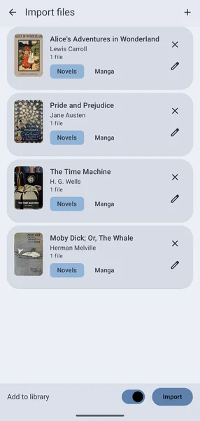
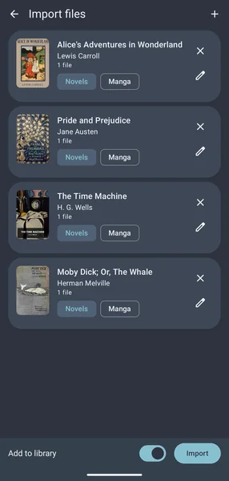

# Local source

If you like to download and organize your media, then you want to know how to manage your own series in Reikai.

::: warning
This page explores some advanced features.
:::

There are two local sources: one for manga, which reads folders of pictures and comic archives, and one for light novels, which reads EPUB books. Both appear in <nav to="sources"> as **Local source**.

## Importing files

The quickest way in is to let Reikai copy the files for you:

* Pick **Import files** in the ⋮ menu of the <nav to="main_library"> or of a **Local source** list.
* Or open an EPUB or comic archive from another app with **Open with** or **Share**, and pick Reikai. With the import screen already open, the file joins the ones you picked.

Reikai reads each file and shows it as the series it will become, with its cover and author. Books that belong to one series (by their series details, or a shared name for comics) are grouped together as its volumes. Tap the pencil to rename a series, or the cross to leave it out. An EPUB can go in as a novel or, for an image-only comic in EPUB form, as manga. With **Add to library** on, the series are added to your library, in your default category or the one you pick.

The files are copied into the folders described below, so you can delete the originals afterwards. Importing a file that is already there skips it, and a new volume of a series you have already imported joins that series.

Files protected with DRM cannot be read. Remove the protection with the tool you bought the book from, or buy it DRM-free.

## Light novels

Local novels live in a `localnovels` folder in your storage location, beside the `local` one. Each folder inside it is a series, and each EPUB in that folder is a volume. Volumes are read in the order of their series number when every book has one, and in name order otherwise. An EPUB placed straight in `localnovels` is a series of its own.

* Chapters come from the book's table of contents. A file that holds several chapters is divided at them, and a part title with no text of its own joins the chapter after it.
* A book with no table of contents gets a chapter per file, or, for a book that is one long file, a chapter per heading.
* Pictures, and the book's own layout such as indents and centred text, carry over. Its text colours give way to your reader theme.
* To change a series' details, put a `details.json` in its folder (the format is in [Advanced editing](/docs/guides/local-source/advanced)). A `cover.jpg` or `cover.png` there replaces the book's own cover.

Chapters you add later appear on the next library update, or when you pull to refresh the series.

## Saving a novel as an EPUB

Any novel, local or not, can be saved as an EPUB file to read in another app or keep as a copy. Open the novel, then **Export as EPUB** in the ⋮ menu. The dialog says how many chapters are on the device: downloaded ones, or every chapter of a local novel. **Download the rest** queues the others first. You can leave out pictures and export only a run of chapters.

To save several at once, select them in the <nav to="main_library"> and pick **Export as EPUB** from the ⋮ menu at the bottom. Reikai asks for a folder and writes one file per novel.

## Creating local manga

1. In the location you specified as your storage location (e.g., `/Reikai/`), create a `local` folder if one is not there yet. Place correctly structured series inside that (e.g. `/Reikai/local/`).

    > If adding series in folders it is recommended to add a file named `.nomedia` to the local folder so images do not show up in the gallery.

1. You should now be able to access the series in <nav to="sources"> under **Local source**. If the list is filtered to novels by the chip row at the top, switch it back to manga or all.

If you add more chapters then you'll have to manually refresh the chapter list (by pulling down the list).

Supported chapter formats are folders with pictures inside (such as `.jpg`, `.png`, etc), archive files (`ZIP`/`CBZ`, `RAR`/`CBR`, `7Z`/`CB7` and `TAR`/`CBT`), or an `EPUB`.
But expect better performance with directories and `ZIP`/`CBZ`.

Note that a single folder or archive file is treated as a single chapter, and so is an EPUB in the `local` folder. Only the light novel source, reading from `localnovels`, divides an EPUB into chapters.

### Folder structure

Reikai requires a specific folder structure for local series to be correctly processed.
Local series will be read from the `local` folder.
Each series must have a `Series` folder and a `Chapter` folder.
Images will then go into the chapter folder.
See below for more information on archive files.
You can refer to the following example:

:::info Example

  <ul>
    
    [your storage location]/local
    <li>
      
      [the series title]
      <ul>
        <li>
          
          cover.jpg
        </li>
        <li>
          
          chapter_1
          <ul>
            <li>image_1.ext</li>
            <li>image_n.ext</li>
          </ul>
        </li>
        <li>
          
          chapter_2
          <ul>
            <li>image_1.ext</li>
            <li>image_n.ext</li>
          </ul>
        </li>
        <li>
          
          chapter_n
          <ul>
            <li>image_1.ext</li>
            <li>image_n.ext</li>
          </ul>
        </li>
      </ul>
    </li>
  </ul>

:::

Reikai will see three chapters in a single series.
The path to the folder with images must contain both the series title and the chapter name (as seen above).

Note that this is the same folder structure used by downloads of non-local sources.
However, the filename format is not required to be the same; for example, Reikai can add a disambiguating hash based on the chapter URL when downloading chapters (the **Enable chapter name hash suffix** setting in <nav to="advanced">), but you do not need to do this.

### Archive files

Archive files such as `ZIP`/`CBZ` are supported but the folder structure inside is not.
Any folders inside the archive file are ignored.
You must place the archive inside the `Series` folder where the name will become the `Chapter` title.
All images inside the archive regardless of folder structure will become pages for that chapter.

#### Example {#example-archives}

:::tabs
== .ZIP

  <ul>
    
    [your storage location]/local
    <li>
      
      [the series title]
      <ul>
        <li>
          
          cover.jpg
        </li>
        <li>
          
          chapter_1.zip
          <ul>
            <li>
              
              image_1.jpg
            </li>
            <li>
              
              image_n.jpg
            </li>
          </ul>
        </li>
        <li>
          
          chapter_2.zip
          <ul>
            <li>
              
              image_1.jpg
            </li>
            <li>
              
              image_n.jpg
            </li>
          </ul>
        </li>
        <li>
          
          chapter_n.zip
          <ul>
            <li>
              
              image_1.jpg
            </li>
            <li>
              
              image_n.jpg
            </li>
          </ul>
        </li>
      </ul>
    </li>
  </ul>

:::

### Volume folders

A series split into volumes can keep each volume in a folder of its own inside the `Series` folder, such as `Vol 01` and `Vol 02`, with the volume's chapter archives or chapter folders inside it. Reikai reads one level of volume folders and names each chapter with its volume in front, like `Vol 02 - Ch 011`. A folder that holds only pictures is still read as one chapter.
