# Statistics

_Dev record: [statistics.md](dev/subsystems/statistics.md). Doc map: [README.md](README.md)._

Open <nav to="statistics">. To reach it faster, set **Statistics shortcut** in <nav to="appearance"> to put it in the ⋮ menu of the Library, Updates and History, or to give it its own tab in the bottom bar, which also takes it out of More. The **All** / **Manga** / **Novels** chips at the top choose what every number, chart and list below counts.

## The overview

By default the first card counts your library, chapters and trackers, each figure with an icon.
Below it:

* **Publishing status** and **Tracking status** list each status with how many series have it and their share of the total. Tracking status counts series you track, by the status of your first signed-in tracker. Tap a status to list those series. On a tablet or an unfolded phone, Publishing status also shows a pie chart with the total in the middle.
* **Scores** has a row for each mean tracker score you have given, from the highest down, with how many series sit at it. Tap a row to list the series at that score.
* **Reading this week** shows your reading time for the last seven days, your time today, your current streak of reading days and your longest one, and your reading speed: the time you spend on a manga page, the words a minute you read in novels, and the words a minute read aloud plays at. Each reads **Learning** until you have finished three chapters of that type.
* **Most read** ranks the series you have spent the longest reading. Tap one to open it, or **See all** for every series you have read.
* **Sources**, **Tags**, **Categories**, **Trackers**, **Languages**, **Series length** and **Started reading** list your top five in each.

::: tabs
== Overview
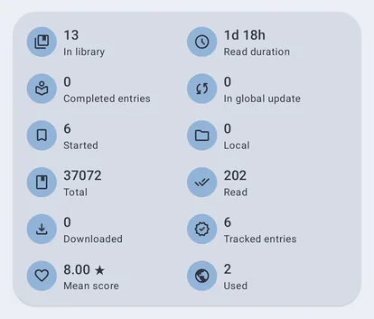
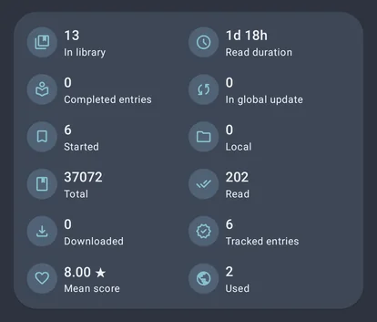
== Reading
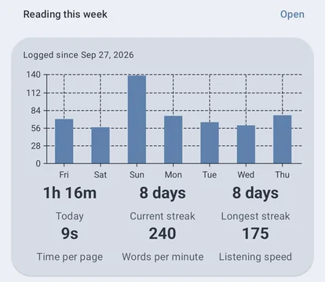
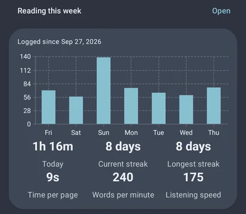
== Charts
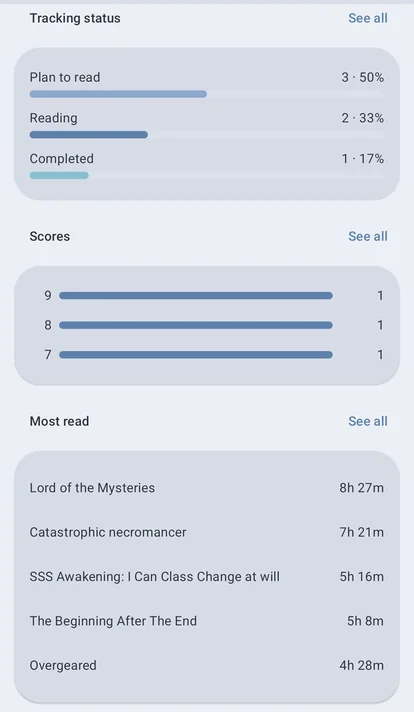
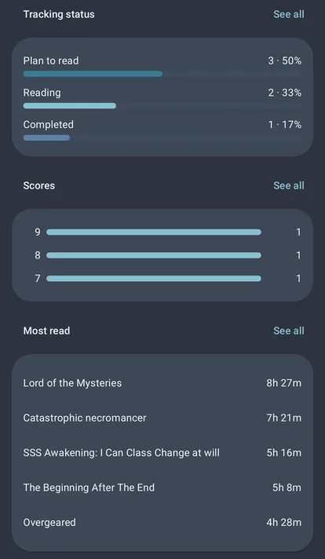
:::

On a tablet or an unfolded phone the cards sit side by side in three groups, **At a glance**, **Charts** and **Your library by**, with every card in a row the same height. A phone shows one column.

A series merged from several sources counts once, except in **Sources**, **Tags**, **Trackers** and **Languages**, where it counts under each one it has. Those lists can add up to more than your library.

## Arranging the cards

Tap the pencil at the top of Statistics to arrange its cards. They sit in three groups: **At a glance**, **Charts** and **Your library by**.

* Drag a group by its handle to move it with all its cards, or drag a card to move it within its group.
* Untick a card to hide it, or untick a group to hide all of its cards. A hidden card stays in the list, so you can tick it again.
* Under **At a glance**, drag a number to move it, or untick it to hide it, such as the tracker ones if you don't use trackers.
* Tap the arrow beside a group to fold it while you arrange the others.
* **Reset** in the ⋮ menu puts every card back in its first place and shows them all.

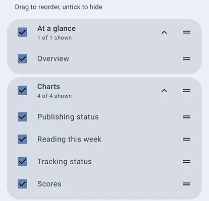
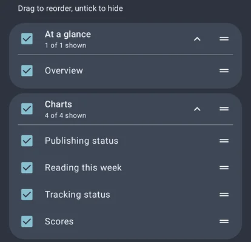

## Opening a list

**See all** on a card opens the whole list, one card per row on a phone and several side by side on a wider screen. Each shows how many of its series you have **Finished** (read every chapter), are **Reading** and have **Not started**, then its mean score and reading time. Where the list has no order of its own, the sort button in the top bar orders it by most series, chapters read, mean score or reading time.

Tap a row to list the series it counts, drawn as your library draws them: the same display mode, columns, sort and badges, but none of its filters, so the list always matches the row. The row's card sits on top; tap **Finished**, **Reading** or **Not started** on it to narrow the list, and again to clear it. Tap a series to open it; back returns to the list, then to Statistics where you were.

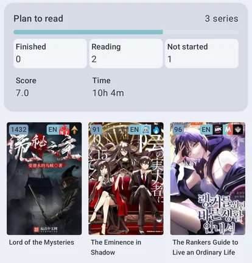
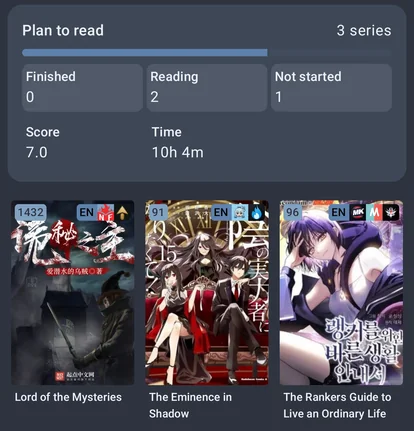

## Reading time

**Open** on **Reading this week** shows your reading time with the series you read and for how long. Pick **Week** (the last seven days, a bar per day), **Month** (a bar per day) or **Year** (a bar per month), or **Custom** to choose any dates: up to two months gets a bar per day, up to three years a bar per month, and longer a bar per year. The arrows step back or forward by the same length. Tap a bar to list only its dates, and tap it again to see the whole period. Tap a series to open it.

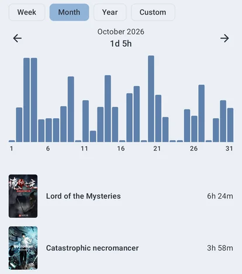
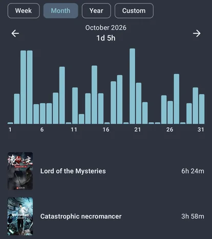

Reading time per day is recorded from version 0.5.0 on. Reading from before that still counts toward the overview's total, but not toward any day, streak or the reading-time lists, since earlier versions kept only each chapter's total.
Clearing all of your history clears the daily record too.

## Started reading

**Started reading** groups your series by the year you started them. It uses the start date a tracker holds for the series. Without one, it uses the first day the app recorded you reading it. A series with neither is **Unknown**.
